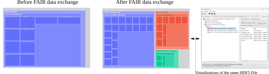
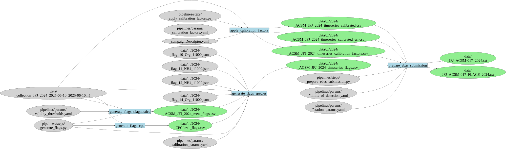

# ACSM FAIRifier

**ACSM FAIRifier** is a containerized JupyterLab-based toolkit for preparing Aerosol Chemical Speciation Monitor (ACSM) datasets for EBAS submission and domain-agnostic reuse. It enables users to transform raw or processed ACSM data into:

- **EBAS-compliant outputs**, with appropriate metadata and file structure  
- **Self-describing HDF5 files**, containing final and intermediate data products for transparent, reusable, and reproducible science

> **Try it without installing anything:** the toolkit runs in your browser on [Renku](https://renkulab.io/p/juanflo16/acsm-fairifier-workbench). See [Choose How to Run](#choose-how-to-run) and the [Renku guide](docs/renku-deployment/README_renku.md).

---

### Key Features

- Notebook-driven pipelines with automatic **provenance tracking**  
- Notebook-driven visualizations of data products  
- **Dash Plotly app** for interactive data annotation for quality control  
- Direct integration with an HDF5-based data structure  
- HDF5 output includes **intermediate data products** in addition to final outputs  

---

### Input Format

The ACSM data integration pipeline reads data from an **input directory** and an **instrument folder** specified in the `campaignDescriptor.yaml` file with key-value pairs as follows:

```yaml
input_file_directory : NETWORK_MOUNT/Data/JFJ/
instrument_datafolder: ACSM_TOFWARE/2024/
```
Make sure the combined path contains the following structure and files:

```swift
NETWORK_MOUNT/Data/JFJ/ACSM_TOFWARE/2024/
├── ACSM_JFJ_2024_meta.txt
├── ACSM_JFJ_2024_timeseries.txt
├── CH0001G.20240101000000...lev1.nas
├── Org_data_valid.csv
├── Org_err_valid.csv
├── Org_mz_valid.csv
├── Org_time_valid.csv
└── params/
    ├── calibration_params.yaml
    ├── limits_of_detection.yaml
    └── validity_thresholds.yaml
```

The input directory does not have to be a network drive: a local folder works too, e.g. `input_file_directory: '../data/<your_folder>/'` (relative to `notebooks/`).

### Sample Data

To try the toolkit without access to station data, download the sample campaign:

```bash
python scripts/get_sample_data.py
```

The script downloads the archive set in `SAMPLE_DATA_URL`, verifies it against `SAMPLE_DATA_MD5`, unpacks it into `data/sample/`, and checks the folder structure above. Then use `campaignDescriptor.sample.yaml` instead of `campaignDescriptor.yaml` in the main notebook.

### Output Formats

- **NAS EBAS-compliant files**, structured and metadata-rich for archive submission  
- **Self-describing HDF5 files**, including:
  - Project-level, contextual, and data lineage metadata  
  - Intermediate and final processed datasets  
- **YAML workflow file**, automatically generated in [Renku format](https://renku.readthedocs.io/en/stable/topic-guides/workflows/workflow-file.html),  
  recording the **prospective provenance** of the data processing chain (i.e., planned steps, parameters, and dependencies)

---

### Extensibility

While designed for ACSM datasets, the FAIRifier framework is modular and adaptable to new instruments and processing pipelines. Email the authors for details.

---

### Visual Overview of Domain-Agnostic Data Products

<p align="center">
  
</p>

<p align="center">
  
</p>

---


## Repository Structure 
<details> 
<summary> <b> Click here to see the structure </b> </summary>

   - `app/` — Dash Plotly app for interactive data flagging
   - `data/` — Contains ACSM datasets in HDF5 format (input/output)
   - `dima/` — Submodule supporting HDF5 metadata structure
   - `notebooks/` — Jupyter notebooks for stepwise FAIRification and submission preparation
   - `pipelines/` — Data chain scripts powering the transformation workflow
   - `scripts/` — Helper scripts (e.g., `get_sample_data.py`)
   - `docs/` — Additional documentation resources, including:
     - `docs/renku-deployment/` — Renku user guide (`README_renku.md`) and deployment instructions for maintainers (`instructions.md`)
     - `docs/data-flow-architecture/` — Architecture notes (e.g., serving the Dash app through Jupyter Server Proxy)
   - `figures/` — Generated plots and visualizations
   - `tests/` — Baseline tests for the legacy converter and the pipeline (see [Testing](#testing))
   - `third_party/` — External code dependencies
   - `workflows/` — Workflow (provenance) YAML files describing data processing chains, in Renku workflow format
   - Configuration files:  
     - `Dockerfile.acsmchain.renku` for container builds (local Docker and Renku)  
     - `Dockerfile.acsmchain` for the earlier local-only container build  
     - `docker-compose.yaml` for running the container locally  
     - `env_setup.sh` to bootstrap local environment  
   - Project metadata files: `README.md`, `LICENCE`, `CITATION.cff`, `CHANGELOG.md`, `TODO.md`, `campaignDescriptor.yaml`, and `campaignDescriptor.sample.yaml`.

</details>

## Getting Started

### Choose How to Run

| Option | Best for | You need | Data access | Instructions |
|---|---|---|---|---|
| **Renku** (browser) | Trying the toolkit, sharing with collaborators | A web browser | Sample data or files uploaded into the session | [Renku guide](docs/renku-deployment/README_renku.md) |
| **Docker** (local) | Regular processing on your own machine | Docker Desktop, Git Bash | Local folders, or the PSI network drive | [Run the ACSM FAIRifier Toolkit](#run-the-acsm-fairifier-toolkit) |
| **Conda** (local, no Docker) | Development and debugging | Miniforge | Local folders, or the PSI network drive | [Set Up the Python Environment](#optional-set-up-the-python-environment) |

### Requirements

The following apply to the local options (Docker and Conda). For Windows users, the following are required:

1. **Docker Desktop**: Required to run the toolkit using containers. [Download and install Docker Desktop](https://www.docker.com/products/docker-desktop/).

2. **Git Bash**: Used to run shell scripts (`.sh` files).

3. **Miniforge (Optional)**: Install [Miniforge](https://conda-forge.org/download/). Required only if you plan to run the toolkit **outside of Docker**.

4. **Graphviz (for workflow visualizations)**: Install [Graphviz for Windows](https://graphviz.gitlab.io/_pages/Download/Download_windows.html). Needed to render workflow `.yaml` files as graphs. After installation, add the `Graphviz/bin` folder (e.g. `C:\Program Files\Graphviz\bin`) to your system **PATH**. Not needed with Docker or Renku, where Graphviz is included in the image.

5. **PSI Network Access** *(for data retrieval)*: Needed only if accessing live data from a PSI network-mounted drive.

## Clone the Repository

> **Two repositories:** The toolkit is developed at PSI ([gitea.psi.ch/apog/acsm-fairifier](https://gitea.psi.ch/apog/acsm-fairifier)) and mirrored on GitHub ([github.com/jfflorez/acsm-fairifier](https://github.com/jfflorez/acsm-fairifier)), where the Renku deployment is maintained on the `main-renku` branch. PSI users can clone either; external users should use GitHub. The `dima` submodule is hosted on PSI's public Gitea and is reachable from both.

Open **Git Bash** and run one of the following:

```bash
# PSI (Gitea)
git clone --recurse-submodules https://gitea.psi.ch/apog/acsm-fairifier.git

# GitHub mirror (includes the Renku deployment)
git clone --recurse-submodules --branch main-renku https://github.com/jfflorez/acsm-fairifier.git

cd acsm-fairifier
```

## Run the ACSM FAIRifier Toolkit

This toolkit includes a containerized JupyterLab environment for executing the data processing pipeline, plus an optional dashboard for manual flagging.

1. Open **PowerShell as Administrator** and navigate to the `acsm-fairifier` repository.  
2. Create a `.env` file in the root of `acsm-fairifier/`.  
3. **Securely store your network drive access credentials** in the `.env` file by adding the following lines: 
   ```plaintext
   CIFS_USER=<your-username>
   CIFS_PASS=<your-password>   
   NETWORK_MOUNT=//your-server/your-share
   ```
   **To protect your credentials:**
   - Do not share the .env file with others.
   - Ensure the file is excluded from version control by adding .env to your .gitignore and .dockerignore files.
4. Open **Docker Desktop**, then build the container image:
   ```bash
   docker build -f Dockerfile.acsmchain.renku -t datachain_processor .
   ```
   The same image definition is used locally and on Renku. It contains the environments only; your cloned code is mounted into the container at start.
5. Start the toolkit:

   - **Locally without network drive mount:**

     ```bash
     docker compose up datachain_processor
     ```

   - **With network drive mount:**

     ```bash
     docker compose up datachain_processor_networked
     ```

6. Access:
   - **Jupyter Lab**: [http://localhost:8889/lab/](http://localhost:8889/lab/)
   - **Data Flagging App**: starts automatically with Jupyter Lab; open it from the *Data Flagging App* tile in the Jupyter Lab launcher

7. Stop the app:
   In the previously open PowerShell terminal, enter:
   ```bash
   Ctrl + C
   ```
   After the container is properly stopped, remove it with: 
   ```bash
   docker compose down
   ```
## Testing

Check some of the repo's key functionalities by following [`/docs/testing/testing-acsm-fairifier.md`](/docs/testing/testing-acsm-fairifier.md). The tests check that the code still produces the same outputs as before a change. They compare a fresh run with a stored baseline of outputs that were
checked by hand.

| Test | What it covers | Input |
|---|---|---|
| `tests/legacy_converter/` | the legacy EBAS converter | `tests/legacy_converter/data/` |
| `tests/pipeline/` | the whole ACSM pipeline, as in `notebooks/demo_acsm_pipeline.ipynb` | a few days of real data in `tests/pipeline/fixtures/raw/` (or a full year, see below) |


## (Optional) Set Up the Python Environment

   > Required only if you plan to run the toolkit outside of Docker

### Install Python Environment Using Miniforge and conda-forge

We recommend using Miniforge to manage your conda environments. Miniforge ensures compatibility with packages from the conda-forge channel.

1. Make sure you have installed **Miniforge**. 

2. Create the Environment from `environment.yml`
After installing Miniforge, open **Miniforge Prompt** or a terminal with access to conda and run:
   ```bash
   cd path/to/Gitea/acsm-fairifier
   conda env create --file environment.yml
   ```

### Working with Jupyter Notebooks
We now make the previously installed Python environment `acsmnode_env` selectable as a kernel in Jupyter's interface.

1. Open an **Miniforge Prompt**, check if the environment exists, and activate it:
    ```
    conda env list
    conda activate acsmnode_env
    ```
2. Register the environment in Jupyter:
    ```
    python -m ipykernel install --user --name acsmnode_env --display-name "Python (acsmnode_env)"  
    ```
3. Start a Jupyter Notebook by running the command:
    ```
    jupyter notebook
    ```
  and select the `acsmnode_env` environment from the kernel options.


## (Optional) Run the Dashboard App
With Docker or Renku, the dashboard starts automatically (see above). Outside Docker, run the following command from the `app/` folder to start the dashboard app:

   ```bash
   python data_flagging_app.py
   ```

This command will launch the data flagging app.

## (Optional) Stop the Dashboard App

Run the following command to stop the dashboard app:

   ```bash
   CTRL + C
   ```
This command will terminate the server process running the app.

## Authors

This toolkit was developed by:

- Juan F. Flórez-Ospina  
- Leïla H. Simon  
- Nora K. Nowak  
- Benjamin T. Brem  
- Martin Gysel-Beer  
- Robin L. Modini  

All authors are affiliated with the **PSI Center for Energy and Environmental Sciences**, 5232 Villigen PSI, Switzerland.

- For general correspondence: [robin.modini@psi.ch](mailto:robin.modini@psi.ch)  
- For implementation-specific questions: [juan.florez-ospina@psi.ch](mailto:juan.florez-ospina@psi.ch), [juanflo16@gmail.com](mailto:juanflo16@gmail.com)


---

## Funding

This work was funded by the **ETH-Domain Open Research Data (ORD) Program – Measure 1**.

It is part of the project  
**“Building FAIR Data Chains for Atmospheric Observations in the ACTRIS Switzerland Network”**,  
which is described in more detail at the [ORD Program project portal](https://open-research-data-portal.ch/projects/building-fairdata-chains-for-atmospheric-observations-in-the-actris-switzerland-network/).


---

