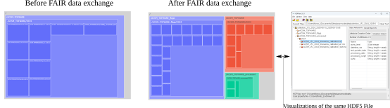
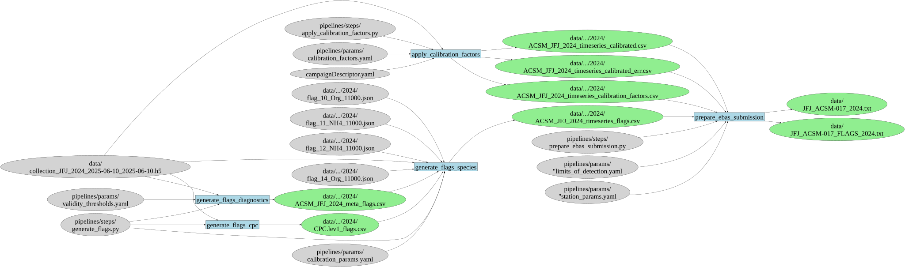

# ACSM FAIRifier

**ACSM FAIRifier** is a containerized JupyterLab-based toolkit for preparing Aerosol Chemical Speciation Monitor (ACSM) datasets for EBAS submission and domain-agnostic reuse. It enables users to transform raw or processed ACSM data into:

- **EBAS-compliant outputs**, with appropriate metadata and file structure  
- **Self-describing HDF5 files**, containing final and intermediate data products for transparent, reusable, and reproducible science

---

### Key Features

- Notebook-driven pipelines with automatic **provenance tracking**  
- Notebook-driven visualizations of data products  
- **Dash Plotly app** for interactive data annotation for quality control  
- Direct integration with an HDF5-based data structure  
- HDF5 output includes **intermediate data products** in addition to final outputs  

---

### Output Formats

- **NAS EBAS-compliant files**, structured and metadata-rich for archive submission  
- **Self-describing HDF5 files**, including:
  - Project-level, contextual, and data lineage metadata  
  - Intermediate and final processed datasets  
- **YAML workflow file**, automatically generated in [Renku format](https://renku.readthedocs.io/en/stable/topic-guides/workflows/workflow-file.html),  
  recording the **prospective provenance** of the data processing chain (i.e., planned steps, parameters, and dependencies)

---

### Extensibility

While designed for ACSM datasets, the FAIRifier framework is modular and adaptable to new instruments and processing pipelines. Email the authors for details.

---

### Visual Overview of Domain-Agnostic Data Products

<p align="center">
  
</p>

<p align="center">
  
</p>

---


## Repository Structure 
<details> 
<summary> <b> Click here to see the structure </b> </summary>

   - `app/` — Dash Plotly app for interactive data flagging
   - `data/` — Contains ACSM datasets in HDF5 format (input/output)
   - `dima/` — Submodule supporting HDF5 metadata structure
   - `notebooks/` — Jupyter notebooks for stepwise FAIRification and submission preparation
   - `pipelines/` — Data chain scripts powering the transformation workflow
   - `docs/` — Additional documentation resources
   - `figures/` — Generated plots and visualizations
   - `third_party/` — External code dependencies
   - `workflows/` — Workflow automation (e.g., CI/CD pipelines)
   - Configuration files:  
   - `Dockerfile.acsmchain` for container builds  
   - `docker-compose.yaml` for orchestrating multi-container setups  
   - `env_setup.sh` to bootstrap local environment  
   - Project metadata files: `README.md`, `LICENSE`, `CITATION.cff`, `TODO.md`, and `campaigndescriptor.yaml`.

</details>

## Getting Started

### Requirements

For Windows users, the following are required:

1. **Docker Desktop**: Required to run the toolkit using containers. [Download and install Docker Desktop](https://www.docker.com/products/docker-desktop/).

2. **Git Bash**: Used to run shell scripts (`.sh` files).

3. **Conda (Optional)**: Required only if you plan to run the toolkit **outside of Docker**. You can install [Anaconda](https://www.anaconda.com/products/distribution) or [Miniconda](https://docs.conda.io/en/latest/miniconda.html).  

4. **PSI Network Access** *(for data retrieval)*: Needed only if accessing live data from a PSI network-mounted drive.

## Clone the Repository

Open **Git Bash** and run:

```bash
cd Gitea
git clone --recurse-submodules https://gitea.psi.ch/apog/acsmnode.git
cd acsmnode
```

## Run the ACSM FAIRifier Toolkit

This toolkit includes a containerized JupyterLab environment for executing the data processing pipeline, plus an optional dashboard for manual flagging.

1. Open **PowerShell as Administrator** and navigate to the `acsmnode` repository.  
2. Create a `.env` file in the root of `acsmnode/`.  
3. **Securely store your network drive access credentials** in the `.env` file by adding the following lines: 
   ```plaintext
   CIFS_USER=<your-username>
   CIFS_PASS=<your-password>
   ```
   **To protect your credentials:**
   - Do not share the .env file with others.
   - Ensure the file is excluded from version control by adding .env to your .gitignore and .dockerignore files.
4. Open **Docker Desktop**, then build the container image:
   ```bash
   docker build -f Dockerfile.acsmchain -t datachain_processor .
   ```
5. Start the toolkit:

- **Locally without network drive mount:**

  ```bash
  docker compose up datachain_processor

- **With network drive mount:**

  ```bash
  docker compose up datachain_processor_networked

6. Access:
   - **Jupyter Lab**: [http://localhost:8889/lab/tree/notebooks/](http://localhost:8889/lab/tree/notebooks/)

7. Stop the app:
   In the previously open PowerShell terminal, enter:
   ```bash
   Ctrl + C
   ```
   After the container is properly Stopped, remove the container process as: 
   ```bash
   docker rm $(docker ps -aq --filter ancestor=datachain_processor)
   ```


## (Optional) Set Up the Python Environment

   > Required only if you plan to run the toolkit outside of Docker

If **Git Bash** lacks a suitable Python interpreter, run:

```bash
   bash env_setup.sh
```


## (Optional) Run the Dashboard App
Run the following command to start the dashboard app:

   ```bash
   python data_flagging_app.py
   ```

This command will launch the data flagging app.

## (Optional) Stop the Dashboard App

Run the following command to stop the dashboard app:

   ```bash
   CTRL + C
   ```
This command will terminate the server process running the app.

## Authors

This toolkit was developed by:

- Juan F. Flórez-Ospina  
- Leïla H. Simon  
- Nora K. Nowak  
- Benjamin T. Brem  
- Martin Gysel-Beer  
- Robin L. Modini  

All authors are affiliated with the **PSI Center for Energy and Environmental Sciences**, 5232 Villigen PSI, Switzerland.

- For general correspondence: [robin.modini@psi.ch](mailto:robin.modini@psi.ch)  
- For implementation-specific questions: [juan.florez-ospina@psi.ch](mailto:juan.florez-ospina@psi.ch), [juanflo16@gmail.com](mailto:juanflo16@gmail.com)


---

## Funding

This work was funded by the **ETH-Domain Open Research Data (ORD) Program – Measure 1**.

It is part of the project  
**“Building FAIR Data Chains for Atmospheric Observations in the ACTRIS Switzerland Network”**,  
which is described in more detail at the [ORD Program project portal](https://open-research-data-portal.ch/projects/building-fairdata-chains-for-atmospheric-observations-in-the-actris-switzerland-network/).


---
