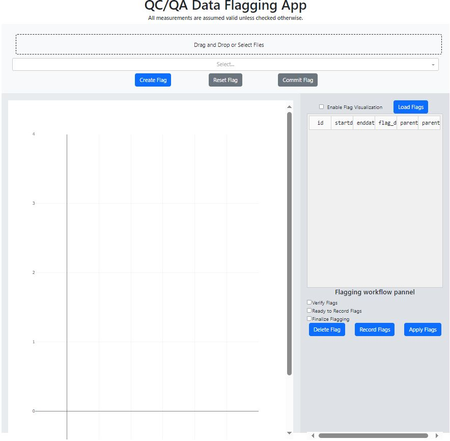

# TODO
* [New] FLAGGING APP. Review data flagging app. For some reason Chl_10000 channel not showing and parent provance recording is wrong.
* [New] Review DataManager File Update. Generated CSV files are not transfering properly.
* [New] FAIL APPENDDIR TRANSFER. Ensure code snippets that open and close HDF5 files do so securly and do not leave the file locked 
* [New] Learn how to run docker-compose.yaml
* [New] EBAS_SUBMISSION_STEP. Extend time filter to ranges, create a merge data frame function, and construct file name and output dir dynammically.   It is currently hardcoded.  
* [New] Finish command line interface for visualize_datatable_vars and add modes, --flags, --dataset, and save to figures folder in repo

* Implement flagging-app specific data operations such as:
    1. [New item] When verify flags from checklist is active, enable delete-flag button to delete flag associated with active cell on table. 
    2. [New item] When verify and ready to trasnfer items on checklist are active, enable record-flags button to record verified flags into the HDF5 file.
    3. [New item] When all checklist items active, enable apply button to apply flags to the time series data and save it to the HDF5 file.
    1. ~~Define data manager obj with apply flags behavior.~~
    2. Define metadata answering who did the flagging and quality assurance tests?
    3. Update intruments/dictionaries/ACSM_TOFWARE_flags.yaml and instruments/readers/flag_reader.py to describe metadata elements based on dictionary.  
    4. ~~Update DIMA data integration pipeline to allowed user-defined file naming template~~
    5. ~~Design and implement flag visualization feature: click flag on table and display on figure shaded region when feature is enabled~~
    6. Implement schema validator on yaml/json representation of hdf5 metadata
    7. Implement updates to 'actris level' and 'processing_script' after operation applied to data/file? 

* ~~When `Create Flag` is clicked, modify the title to indicate that we are in flagging mode and ROIs can be drawn by dragging.~~

* ~~Update `Commit Flag` logic:~~
  ~~3. Update recorded flags directory, and add provenance information to each flag (which instrument and channel belongs to).~~

* Record collected flag information initially in a YAML or JSON file. Is this faster than writing directly to the HDF5 file?

* Should we actively transfer collected flags by clicking a button? after commit button is pressed, each flag is now stored in an independent json file

* Enable some form of chunk storage and visualization from the HDF5 file. Iterate over chunks for faster display versus access time.
    1. Do I need to modify DIMA?
    2. What is a good chunk size?
    3. What Dash component can we use to iterate over the chunks?

