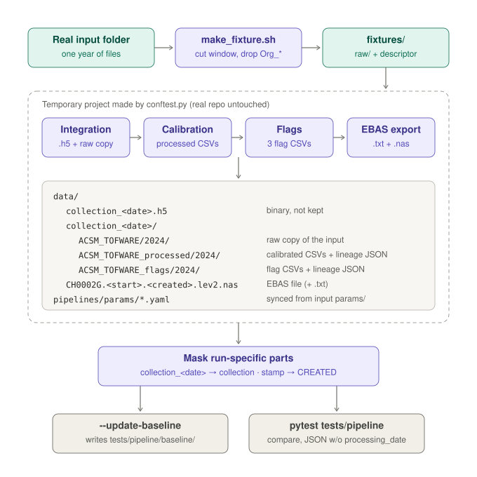

# Pipeline test 

This test evaluates the correct functioning of the main acsm pipeline (normally operated by a scientist using the `notebooks/demo_acsm_pipeline.ipynb`). To do so, the test runs `tests/pipeline/test_pipeline_baseline.py` on input data from the folder `tests/pipeline/fixtures`. 


## How the fixture was created

The content here `tests/pipeline/fixtures` is a few days cut from one year of real JFJ data; built by `tests/pipeline/make_fixture.sh` as follows:

```Bash
bash tests/pipeline/make_fixture.sh Data/collection_1_JFJ_2024_2025-09-23 2024-05-06 2024-05-10.
```
The command records the source folder and the time window on the command line, and writes the folder `raw/` and `campaignDescriptor.yaml`. *Note: during execution the test overrides the YAML file input and output paths*.

## How the test uses uses the fixture



### Workflow
1. **`make_fixture.sh`** cuts a time window from the real input folder into
   `raw/` (see the table below) and writes `campaignDescriptor.yaml` with
   `test_month_range` set from the window.
2. **`conftest.py`** copies the parts of the repo the steps write into to a
   temporary project, so the real `pipelines/params/`, `data/` and
   `third_party/` are never changed.
3. **The steps run in the notebook's order** there: integration (dima) →
   `update_datachain_params` → calibration → flags (diagnostics, cpc, species)
   → ACTRIS header → EBAS export and legacy converter → `.nas` fixes.
   Calibrated and flags CSV paths are taken from the steps' return values.
4. **Everything they leave behind is kept with the same folder structure**:
   dima's copy of the input, the processed and flags CSVs, one
   `data_lineage_metadata.json` per output folder, the EBAS `.txt`/`.nas`
   files and the synced `pipelines/params/*.yaml`. The `.h5` is binary and
   not kept.
5. **Only run-specific parts are masked**: dima's `collection_…_<date>` folder
   becomes `collection`; each `.nas` creation stamp becomes `CREATED` in the
   file name and `<CREATED>`/`<DATE>` inside the file (`tests/nas_masking.py`,
   shared with the legacy converter test); the temp project path becomes
   `<PROJECT>`.
6. **`--update-baseline`** writes the result to `tests/pipeline/baseline/`;
   **plain `pytest tests/pipeline`** compares with it: CSVs as tables
   (relative tolerance 1e-9), lineage JSON without `processing_date`, all other
   files as exact text.

Real-data mode skips step 1: set `ACSM_TEST_DESCRIPTOR` to a descriptor whose
`input_file_directory` is the real input, and `ACSM_BASELINE_DIR` to a folder
outside the repo.

### What is in `tests/pipeline/fixures/raw/`

| Input file | In the fixture | Why |
|---|---|---|
| `ACSM_<station>_<year>_timeseries.txt` | rows inside the window | read by `apply_calibration_factors` and `generate_flags --flag-type species` |
| `ACSM_<station>_<year>_meta.txt` | rows inside the window | read by `generate_flags --flag-type diagnostics` |
| `*CH02L_TSI_3772_<station>.CH02L_CPC.lev1.nas` | header + rows inside the window | read by `generate_flags --flag-type cpc` |
| `params/*.yaml` | unchanged | read by `update_datachain_params` |
| `Org_*.csv` | **left out** | see below |

Rows are kept or dropped byte for byte; no value is rewritten.

### Why the `Org_*.csv` files are left out

- No pipeline step reads them. Each step looks up its input by name and only
  asks for the files in the table above. The `Org_*.csv` files only end up
  inside the `.h5` (and dima's copy of the input) during integration.
- Verified on the full 2024 JFJ data (2026-11-17): running the pipeline with
  and without the `Org_*.csv` files gives byte-identical outputs (calibrated
  and flags CSVs, EBAS `.txt`, `.nas`, params); the only differences were the
  `processing_date` entries in `data_lineage_metadata.json`.
- They cannot be cut to the same time window consistently: their row counts
  differ (`Org_data_valid` 104669, `Org_err_valid` 104647, `Org_mz_valid` 216,
  `Org_time_valid` 63742 in the 2024 JFJ data), and no code in this repository
  says which time each row belongs to.

Consequence: the fixture baseline has no `Org_*.csv` under
`data/collection/<instrument_datafolder>/`, and the fixture test does not
cover their ingestion. The full-data test (`ACSM_TEST_DESCRIPTOR` pointing at
the real input) still does.
